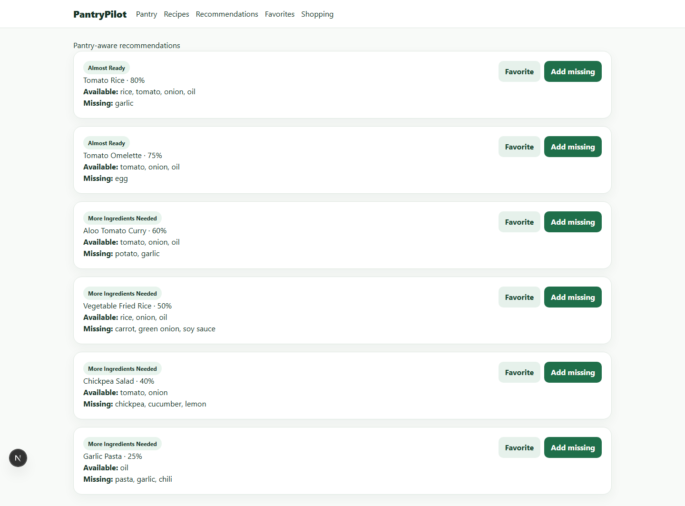

# PantryPilot — Meal Suggester

A single-user meal suggester built with Next.js, Express, TypeScript, and MongoDB for B.Tech Software Project Management coursework.

## Problem and objectives

Choosing meals often involves checking available ingredients against recipes manually. PantryPilot helps students and home cooks maintain a pantry, find matching recipes, identify missing ingredients, save favorites, and prepare shopping lists. The project aims to simplify meal planning and encourage efficient ingredient use.

## Features

| Module | Functionality |
| --- | --- |
| Dashboard | Pantry and favorite counts, recommendation counts, shopping progress |
| Pantry | Add, view, edit, delete ingredients; optional quantity and unit |
| Recipes | Six sample recipes; create, search, view, edit, delete |
| Recommendations | Ingredient match percentage, ranking, available/missing ingredients |
| Favorites | Save and remove recipes |
| Shopping | Generate missing ingredients, mark purchased, remove items |



See [all seven application screenshots](docs/screenshots/README.md) for the pantry-to-shopping demonstration.

## Technology and structure

| Layer | Technology | Location |
| --- | --- | --- |
| Frontend | Next.js, React, TanStack Query, Tailwind CSS, TypeScript | `apps/frontend` |
| Backend | Express, Zod, Mongoose, TypeScript | `apps/backend` |
| Database | MongoDB | Models under backend `src/modules` |
| Tests | Vitest, Supertest, Playwright | Workspace test directories |
| Documentation | Requirements, planning, design, risks, guides | `docs` |

## Windows quick start

Prerequisites: Node.js 20.19+ or 22.13+ is recommended for the locked tooling, npm, and MongoDB Community Server running locally. Docker Desktop is an alternative for MongoDB.

Clone the repository and install its locked dependencies:

```powershell
git clone https://github.com/UditSingh1893/meal-suggester.git
cd meal-suggester
npm ci
npm run seed
npm run dev
```

Open http://localhost:3000. The API runs at http://localhost:4000/api/v1. The shared workspace opens directly using the default configuration. Press Ctrl+C to stop both apps.

If using Docker instead of a local MongoDB installation, start Docker Desktop and run this before seeding:

```powershell
docker compose up -d mongo
```

Alternatively run `npm run dev -w apps/backend` and `npm run dev -w apps/frontend` in separate terminals.

Seeding updates six recipes by slug, preserving pantry, favorites, and shopping lists. Rerunning replaces edits to those sample recipes. Use a dedicated demo database to preserve existing data.

## Configuration

The backend reads process environment variables directly. Use PowerShell to apply overrides, following the names in `.env.example`. The application includes ready-to-use local defaults.

| Variable | Default | Where to set |
| --- | --- | --- |
| `MONGODB_URI` | `mongodb://127.0.0.1:27017/meal_suggester` | PowerShell before seed/start |
| `BACKEND_PORT` | `4000` | PowerShell before start |
| `FRONTEND_ORIGIN` | `http://localhost:3000` | PowerShell before start |
| `NEXT_PUBLIC_API_BASE_URL` | `http://localhost:4000/api/v1` | `apps/frontend/.env.local`, then restart/rebuild frontend |

Example:

```powershell
$env:MONGODB_URI='mongodb://127.0.0.1:27017/meal_suggester_demo'
npm run seed
npm run dev
```

Before starting, run MongoDB on port 27017 and make ports 3000/4000 available. When changing the backend port, update the frontend API URL too.

## Matching rules

Match percentage is the available unique required ingredients divided by all unique required ingredients, multiplied by 100. Four of five ingredients gives **80%**. Categories are Can Make Now at 100%, Almost Ready at 70% to below 100%, and More Ingredients Needed below 70%.

The 70% cutoff is a project choice. Ranking also considers missing ingredient count and cooking time; see [the exact matching rules](docs/matching.md).

The app provides one shared workspace for local meal planning. Matching uses ingredient presence, with normalized names and aliases providing consistent ingredient identity. Pantry quantities and units support inventory recording; optional recipe metadata is available through the API.

## Checks

```powershell
npm test
npm run typecheck
npm run lint
npm run build
```

Root tests and lint target the backend. Browser tests are separate and require running apps, seeded data, and Playwright Chromium:

```powershell
npm exec -w apps/frontend -- playwright install chromium
npm run test:e2e -w apps/frontend
```

Installation and integration-test setup may download a temporary MongoDB executable. Alternatively, tests can use a dedicated existing database:

```powershell
$env:TEST_MONGODB_URI='mongodb://127.0.0.1:27017/meal_suggester_test'
npm test
```

Tests clear collections in that test database. Keep it separate from demo data. See [the test report](docs/test-report.md) for recorded results and coverage.

## Coursework documentation

- [Software requirements specification](docs/requirements.md)
- [Project plan, WBS, and estimates](docs/project-plan.md)
- [Risk register](docs/risk-register.md)
- [Architecture, use cases, and recommendation flow](docs/architecture.md)
- [Database design](docs/database-design.md)
- [API reference](docs/api.md)
- [Matching specification](docs/matching.md)
- [Test report and traceability](docs/test-report.md)
- [User guide and demo walkthrough](docs/user-guide.md)
- [Screenshot gallery and checklist](docs/screenshots/README.md)

## Presentation

[Open the project presentation in Canva](https://www.canva.com/d/KZnXiJCg28I85W9).

## Submission details and attribution

Course: B.Tech fourth year, Software Project Management.

| Team member | Roll number |
| --- | --- |
| Dhruv Sharma | 202311028 |
| Saumya Joshi | 202311039 |
| Kavya Sanghvi | 202311042 |
| Udit Singh | 202311083 |

Faculty guide: Dr. Karan Verma.

Dependency versions are recorded in manifests and the lockfile; their respective licenses apply. Six short recipe examples are in `apps/backend/src/db/seed.ts`. Credit recipe, asset, and code sources and disclose AI assistance according to college policy. This documentation update was prepared with AI assistance from existing source code.
