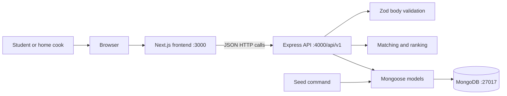
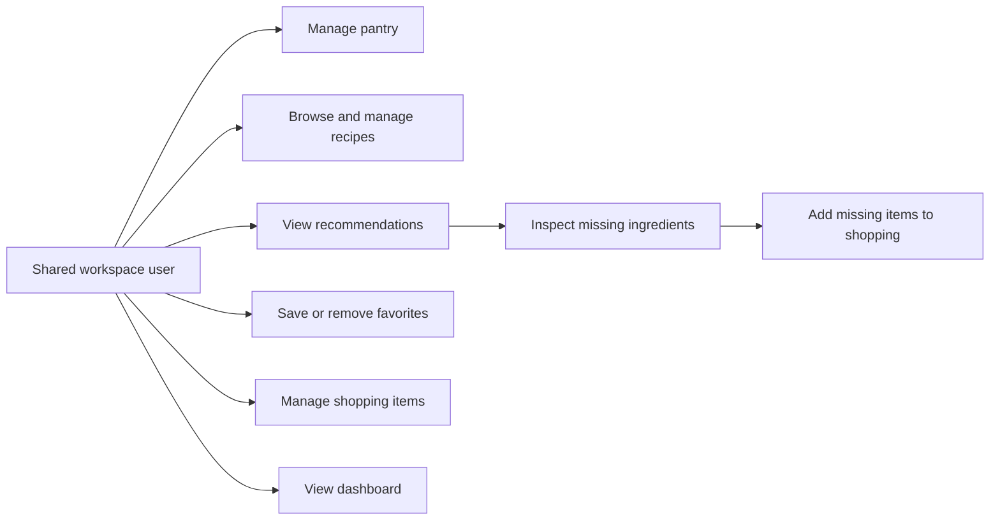
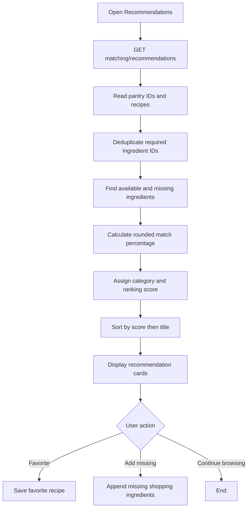

# Architecture and workflows

These diagrams describe the local implementation. GitHub renders Mermaid code blocks.

## System architecture

The browser API client uses NEXT_PUBLIC_API_BASE_URL or localhost. TanStack Query manages frontend requests/caching. Express routes use a fixed demo workspace and Mongoose persistence. Zod validates selected request bodies; central middleware formats errors. The frontend, API, and database form the application runtime.

## Use-case overview

This use-case overview is expressed as a flowchart. All actions are available through the shared local workspace.

## Recommendation activity

The flow shows the recommendation workflow. API middleware manages structured error responses. Exact formulas are in [matching.md](matching.md).
