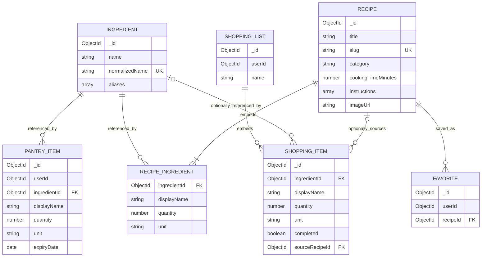

# Database design

MongoDB stores documents through Mongoose. References below represent logical document links managed through Mongoose and application code. Recipe ingredients and shopping items are embedded subdocuments.

## Constraints and lifecycle

| Model | Constraints/behavior |
| --- | --- |
| Ingredient | Unique normalizedName; reused for equivalent names |
| PantryItem | Unique userId/ingredientId pair; quantity nonnegative; expiry optional |
| Recipe | Unique slug; title/category text index; time/category indexes; ingredients embedded using their canonical ingredient ID |
| Favorite | Unique userId/recipeId pair; recipe populated when listing |
| ShoppingList | Indexed by user and update time; embedded items have IDs; completed defaults to false |

Top-level models include creation/update timestamps. API validation requires at least one recipe ingredient and instruction. The diagram reflects valid API-created recipes.

Current routes use userId `000000000000000000000001` as the shared workspace identifier. The schemas retain a User reference name for compatibility with the document structure.

Deleting a pantry item preserves its canonical Ingredient for reuse. Recipe deletion includes favorite cleanup while preserving shopping history. Application code manages the document lifecycle.
