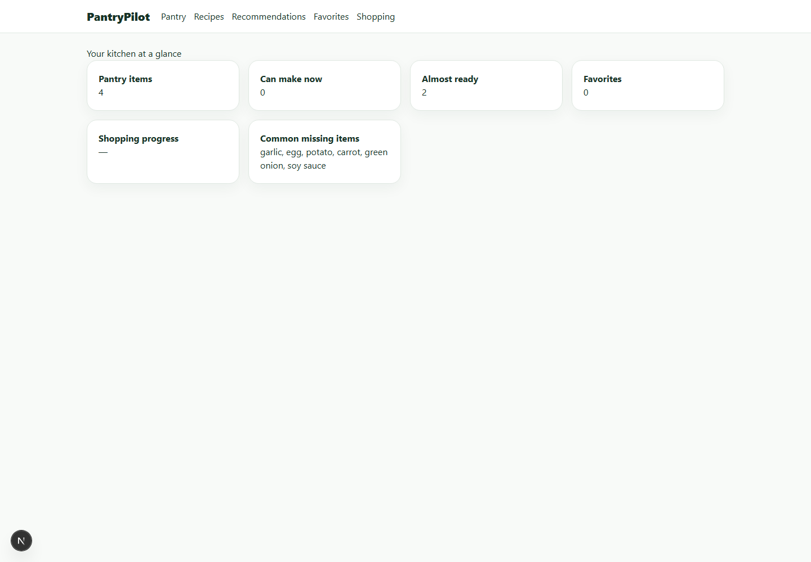
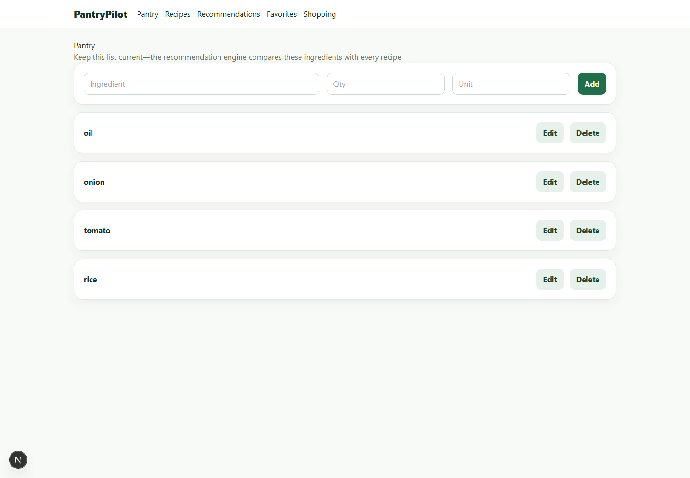
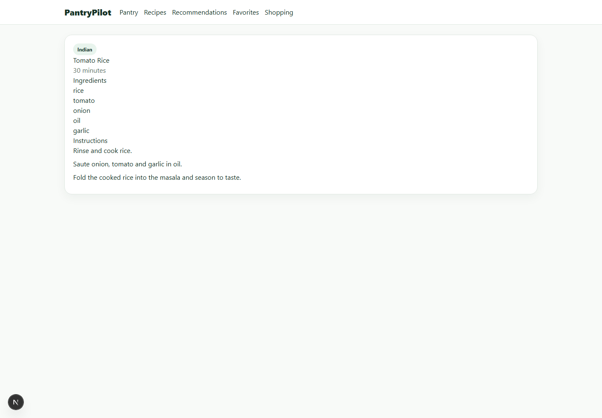
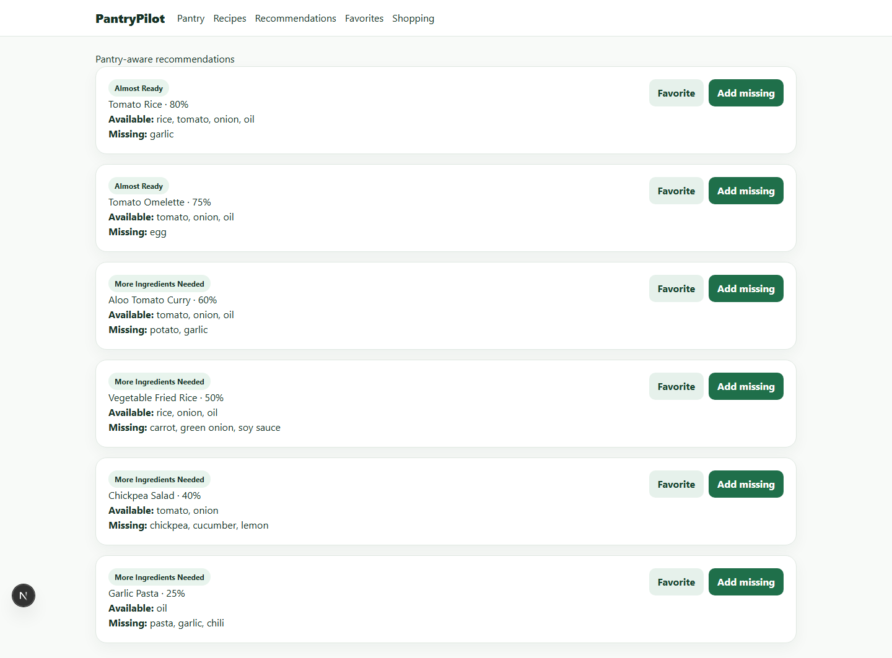
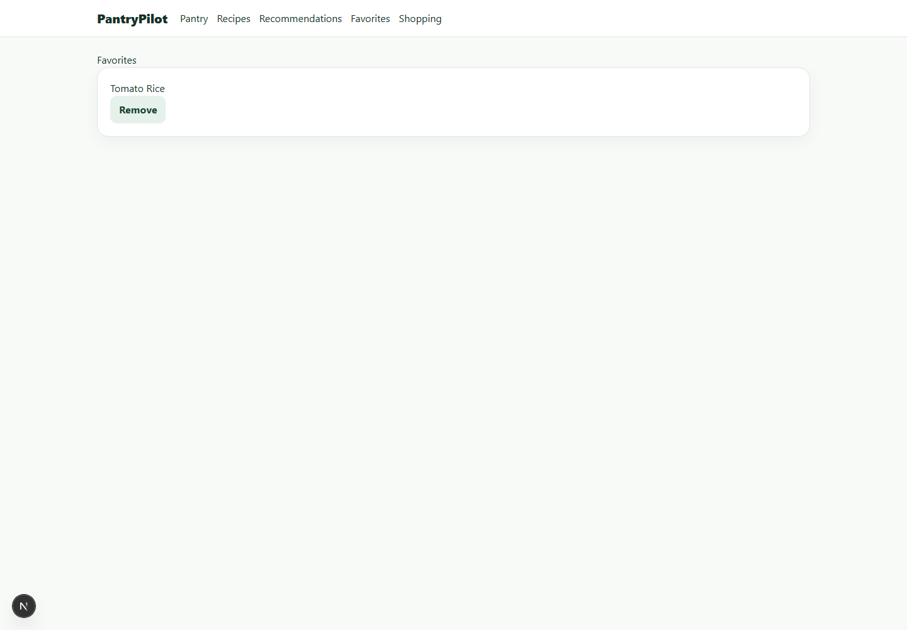
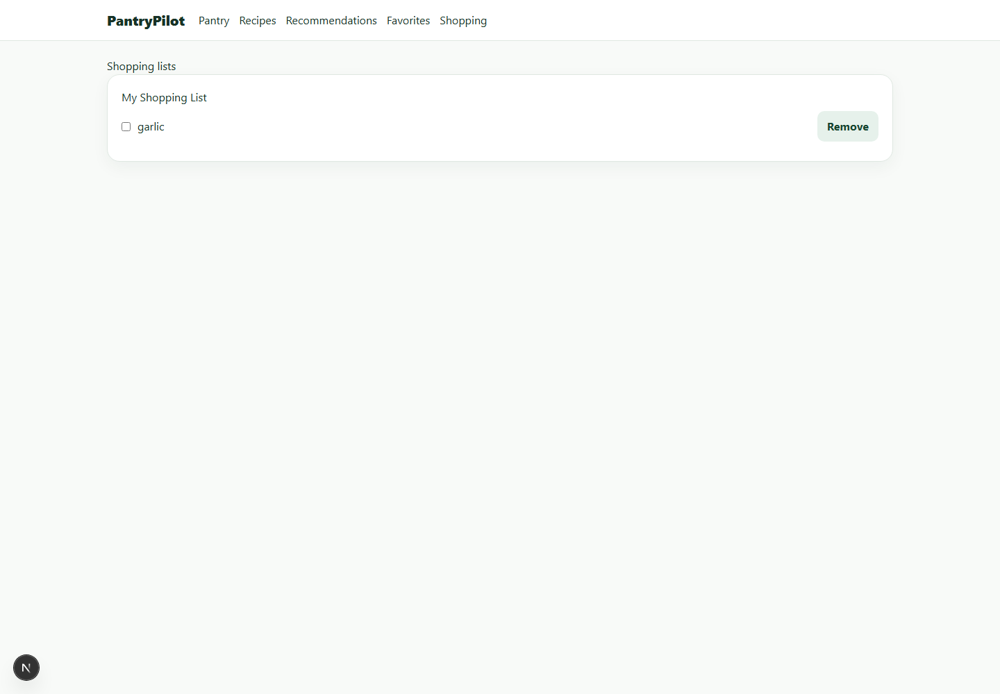
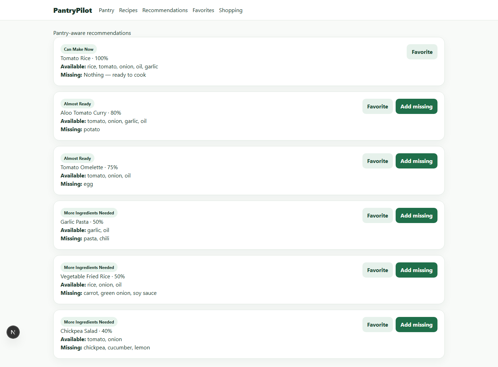

# Screenshot gallery and capture checklist

The gallery presents screenshots captured from the running application.

Follow [the guide](../user-guide.md) using a dedicated seeded demo database. Suggested viewport: 1440 × 1000 at 100% zoom. Wait for data to load; exclude unrelated desktop content and personal data.

| Filename | State | Evidence |
| --- | --- | --- |
| `01-dashboard.png` | Summary after adding four ingredients | FR-08 |
| `02-pantry.png` | Rice, tomato, onion, oil | B-01 |
| `03-recipe-detail.png` | Tomato Rice ingredients/instructions | FR-02 |
| `04-recommendations.png` | Tomato Rice 80%, garlic missing | B-03 |
| `05-favorites.png` | Saved Tomato Rice | B-04 |
| `06-shopping-list.png` | Missing garlic generated | B-05 |
| `07-can-make-now.png` | Tomato Rice 100% after adding garlic | B-06 |

## Captured gallery

Captured 14 November 2026 from the actual local application, using a temporary MongoDB 7.0.24 database seeded with the six sample recipes. Environment: Windows, Next.js 15.5.29 development server, Playwright-controlled installed Chromium revision 1248, viewport 1440 × 1000, full-page PNGs. A separate capture workflow asserted the demonstrated states and saved the original screenshots.

The capture used local ports 13000/14000 and an isolated database. Temporary services were stopped afterward. Each screenshot documents the state described in its caption.

### Dashboard

The initial dashboard shows four pantry ingredients and two Almost Ready recipes, with favorite and shopping counts at their starting values.

### Pantry

The four ingredients used for the 80% example; each was added through the browser.

### Recipe details

The seeded Tomato Rice recipe requires five ingredients and has three instruction steps.

### Partial match

The capture workflow asserted 80% and Almost Ready for Tomato Rice.

### Favorites

The save request succeeded and the favorite heading was verified in the browser.

### Shopping list

Add missing succeeded; garlic was verified on the shopping page.

### Complete match

After adding garlic through Pantry, the workflow asserted 100% and Can Make Now.
